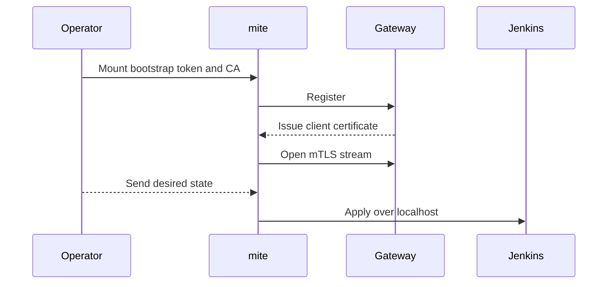

# The mite

The mite is a sidecar in every managed Jenkins pod. It is the authenticated control channel between Varroa and that Jenkins controller.

## What It Does

The mite opens an outbound gRPC stream to the gateway, reports Jenkins health and observed state, applies desired configuration through Jenkins localhost endpoints, and returns command results. It also drains builds during a planned pod termination when a drain timeout is configured.

A healthy Jenkins web interface does not imply a healthy control channel. Varroa cannot converge configuration while the mite is disconnected.

## Registration and Authentication



The bootstrap token is bound to one controller, expires after 15 minutes, and works once. The gateway then issues a 72-hour client certificate for that controller identity. The mite renews the certificate before expiry.

The mite does not store a Jenkins password or API token. The operator sends a short-lived, controller-specific JWT over the mTLS stream. The mite keeps it in memory and presents it to Jenkins as a bearer token. The Varroa security realm plugin verifies the JWT locally.

Registration fails closed if the bootstrap token, certificate authority, or controller identity is invalid.

## Connection Behavior

The mite sends a heartbeat every 15 seconds. A broken stream reconnects with exponential backoff capped at two minutes. Gateway replicas need no sticky routing.

Each desired-state command has a deadline. The default is 20 minutes. Set `ProvisioningDefaults.spec.commandDeadlineSec` to change it.

The gateway extends the 60-second ack wait of a running one-shot command every 15 seconds, so a slow command does not repeat.

The effective reconciliation policy controls termination draining. The default drain timeout is 900 seconds. During termination the mite places Jenkins in quiet-down mode, waits for running builds, then exits when builds finish or the timeout expires.

## Credential Delivery

The desired-state command carries tenant credentials, runner SSH keys, and the mite's Jenkins token. NATS stores no copy. The operator sends each command to the gateway that holds the mite stream. The operator usually pushes the command to a reconnecting mite in the reconcile that sees the new connection. A failed runner read, an armed force-reprovision annotation, or a pod roll moves the push to a later reconcile. While the operator is down, it gets no desired state, and a restarted cell starts without tenant credentials. A token grant can stay queued in JetStream for up to 24 hours.

## Build Claims and Build Events

The mite runs a second listener, bound to `127.0.0.1:9095` only, so nothing outside the pod can
reach it. The Jenkins plugin is its only caller. Two routes serve it:

| Route | Method | Purpose |
|---|---|---|
| `/v1/events` | POST | forward one or more build events toward the [build record store](../operations/build-records.md) |
| `/v1/claim` | POST | ask the ledger for permission to run a queued build, see [Build claims](../operations/build-claims.md) |

The mite writes a random bearer token to `/var/run/varroa/loopback-token`, on the `varroa-loopback`
volume it shares with the Jenkins container. It writes the file before it opens the listener, so
no request can arrive before the token exists. The plugin caches the token and re-reads the file
after a `401`, at most once per second, so a mite restart heals after one failed request.

Both routes travel over the stream the mite already holds to the gateway. The listener runs
whether or not the [build claim gate](../operations/build-claims.md#turn-on-the-gate) is on.

The claim path carries a shrinking timeout budget across all four hops:

| Hop | Budget | Result on expiry |
|---|---|---|
| Plugin to mite, connect | 1 s | empty decision, code `UNAVAILABLE` |
| Plugin to mite, read | 5 s | empty decision, code `UNAVAILABLE` |
| Mite wait for the claim reply | 4.5 s | HTTP `504`, empty decision, code `UNAVAILABLE` |
| Gateway request to the recorder | 4 s | claim reply with empty decision, code `UNAVAILABLE` |

See [Build claims](../operations/build-claims.md) for the environment variables that override
each budget, the retry schedule, and how to read a claim decision.

## Build Events Are Durable

A build event survives three tiers between the Jenkins plugin and the build record store, so a
restart at any tier costs a delay and not a lost event.

1. The plugin spools every event it sends under `$JENKINS_HOME/varroa/spool/`, bounded by
   `VARROA_SPOOL_BYTES` (default 64 MiB), and keeps a spooled event until it is acknowledged.
2. The mite retains every forwarded event in memory, keyed by run and sequence number, bounded
   by `VARROA_EVENT_RETAIN_BYTES` (default 16 MiB). It releases an entry only when the gateway
   acknowledges it. At the cap it stops reading `/v1/events` until room frees up.
3. The gateway acknowledges an event only after the JetStream publish of its whole envelope group
   succeeds. `VARROA_EVENT_PUBLISH_WAIT` (default 10 s) bounds the wait for queue room. After that
   wait, the gateway ends the stream and the mite reconnects.

After a reconnect the mite replays every retained event, in order, before it forwards anything
new. A mite restart loses its retention set, but the plugin's spool resends each
unacknowledged event.

## Diagnose a Mite

The StatefulSet is usually named `<name>-<uid8>`, where `<uid8>` comes from the controller UID. A name that starts with a digit gains a `c-` prefix, and a long name is truncated. List the StatefulSets to find the real name:

```bash
kubectl get statefulset -n <namespace>
```

Inspect the controller first:

```bash
kubectl get controller <name> -n <namespace> \
  -o jsonpath='{.status.phase}{"\n"}{.status.miteStatus}{"\n"}'
kubectl logs -n <namespace> statefulset/<name>-<uid8> -c mite --tail=100
```

| Symptom | Check |
|---|---|
| Phase remains `Running` | Gateway reachability on TCP 9090, bootstrap token errors, and mite logs. |
| `MiteConnected=False`, reason `StreamLost` | The stream was lost after connect. Check the gateway pods. |
| Frequent reconnects | Gateway availability, NetworkPolicy, DNS, and certificate errors. |
| `MiteStreamDegraded=True` | NATS availability, or a NATS grant that denies a gateway subscription. Commands wait while the stream stays connected. |
| Commands time out | Jenkins readiness, command deadline, and long-running configuration work. |
| Planned restart interrupts builds | Effective `drainTimeoutSeconds` and termination grace period. |

Changing `spec.miteSpec.image`, pull policy, or resources requires a pod roll. You can edit these fields in the Spec Editor Form tab. See [Pod customization](../config/pod-customization.md) and [Reconciliation](../operations/reconciliation.md).
